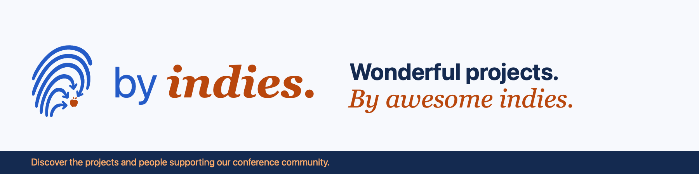

<!-- Generated by Sponsored-by-Indies. Edit the source repository. -->
# By Indies

Independent apps, games, tools and courses, and the people who make them. Every project here contributes to a conference bundle through [Sponsored by Indies](https://sponsored.byindies.com).

Visit [byindies.com](https://byindies.com).

## Make changes

This repository contains the generated website. Its pages, artwork and documentation are published automatically from [Sponsored-by-Indies](https://github.com/dadederk/Sponsored-by-Indies).

Make changes in the source repository. Both websites share the same Swift components, design tokens, styles and content. Read its [README](https://github.com/dadederk/Sponsored-by-Indies#readme) for local previews, content changes and verification commands.

## Get involved

[Report a problem or suggest an improvement](https://github.com/dadederk/Sponsored-by-Indies/issues). To contribute a project or discuss a conference, use the [participation pages](https://sponsored.byindies.com/participate/).

## Credits

Coordinated by [Dani Devesa Derksen-Staats](https://github.com/dadederk), who also writes [Accessibility up to 11](https://accessibilityupto11.com).

Built with [Ignite](https://github.com/Ignite-Swift/Ignite), created by [Paul Hudson](https://github.com/twostraws) and developed with the Ignite community.

Thanks to the independent makers, conference organisers and accessibility community for their contributions and feedback.
